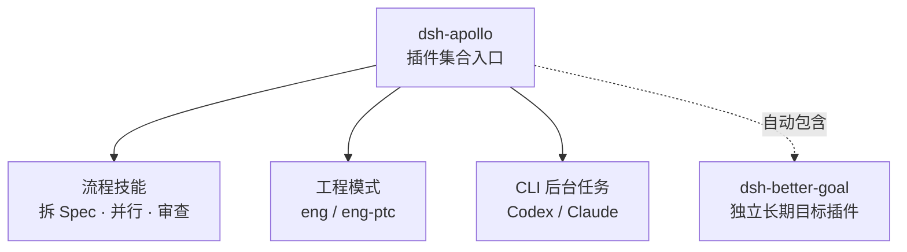
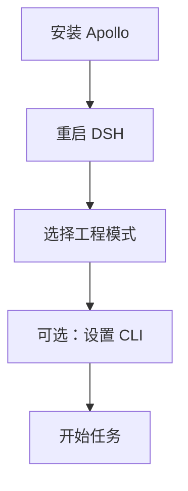
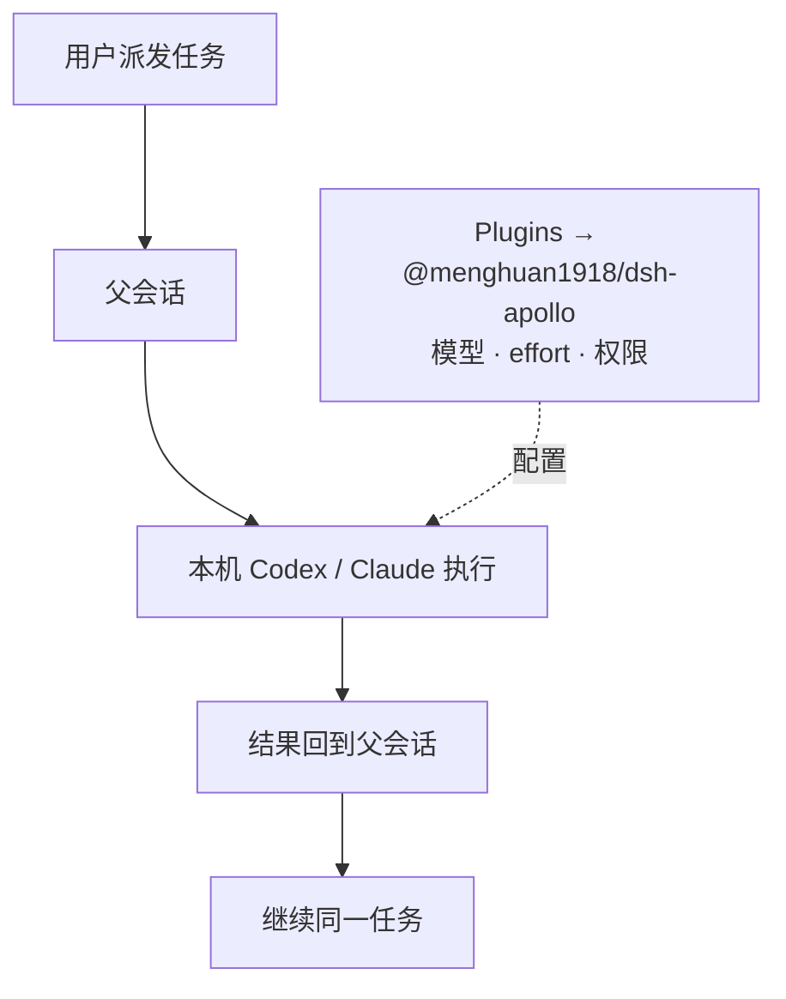

<h1 align="center">dsh-apollo</h1>

<p align="center">
  DeepSeek Harness 的<strong>插件集合入口</strong>：流程技能 · 工程预设 · Codex / Claude 后台任务 · 独立长期目标
</p>

<p align="center">
  <a href="https://www.npmjs.com/package/@menghuan1918/dsh-apollo"></a>
  <a href="LICENSE"></a>
  <a href="package.json"></a>
  <a href="package.json"></a>
</p>

<p align="center">
  <a href="#这是什么">是什么</a> ·
  <a href="#能力地图">能力地图</a> ·
  <a href="#安装">安装</a> ·
  <a href="#cli-后台任务">CLI 后台任务</a> ·
  <a href="#长期目标">长期目标</a> ·
  <a href="#设置与权限">设置与权限</a> ·
  <a href="#faq">FAQ</a> ·
  <a href="docs/DEVELOPMENT.md">开发文档</a>
</p>

## 这是什么

Apollo 是 [DeepSeek Harness](https://github.com/deepseek-ai/deepseek-harness)（DSH）的**插件集合入口**：安装一次，同时得到流程技能、两套工程预设、可续接的 Codex / Claude 后台任务，以及独立的长期目标插件。

> **当前边界**：`dsh-better-goal` 是独立插件包，拥有独立仓库和独立设置行；流程技能、工程预设和 CLI 后台任务目前随 Apollo 一起交付。



## 能力地图

| 模块 | 入口 | 提供什么 |
|---|---|---|
| 流程技能 | 会话内用 `/技能名` 或按描述自动选用 | 把大任务拆成可验证的 Spec，按波次实现、审查、验证后合入 |
| 工程预设 | 预设选择器：`eng` / `eng-ptc` | 工程纪律、委派约定、子代理模型分档、可选退出守卫，以及同一个长期目标 |
| CLI 后台任务 | **Plugins → @menghuan1918/dsh-apollo**；在会话里直接派发 | 让本机 Codex / Claude 在后台执行子任务，结果回到父会话 |
| 长期目标（独立 `dsh-better-goal`） | **Plugins → @menghuan1918/dsh-apollo → `dsh-better-goal` 行** + `/goal` | 每个会话一个持久目标；执行步骤单独跟踪 |

### 流程技能

| 技能 | 用途 |
|---|---|
| `/brainstorming` | 把大型需求设计为获批的主 Spec 与子 Spec |
| `/exec` | 按依赖分波：worktree → 并行子代理实现 → 审查 → 验证与合并 |
| `/dev` | 实现与审查节点的 prompt、报告结构与失败契约 |
| `/main-agent-driven-development` | 实现一个边界明确的单个任务 |
| `/tdd` | 测试先行、红绿循环、测试边界与反模式 |
| `/diagnosing-bugs` | 先建立反馈循环，再定位和修复根因 |
| `/code-review` | 并行检查仓库标准与原始需求，并排报告 |
| `/handoff` | 把当前上下文整理为交接文档；仅由用户手动触发 |

`/dev`、`/tdd` 和 `/diagnosing-bugs` 通常作为 `/exec` 或 `/main-agent-driven-development` 的参考被引用，也可以手动调用。技能需要在所选预设中挂载 DSH 的技能工具，两套工程预设已挂载。

### 工程预设

| 预设（ID） | 适合 | 关键差异 |
|---|---|---|
| 工程模式 — `eng` | 编码 / 基础设施任务 | 原生工具调用；保留 workflow 工具，用法以内置说明为准 |
| 工程(PTC)模式 — `eng-ptc` | 多步、循环、需要过滤汇总的任务 | 工具经 `run_code` 的 TypeScript SDK 调用，一个程序组合多步；与官方 PTC 模式一致不提供 workflow，扇出改为在一个 `run_code` 里派发多个子代理 |

两套预设共用同一段工程模式提示词（KISS、证据先行、修复根因、防过度设计与过度防御、权限与依赖边界、命令与进程纪律、委派与编排），并按设置渲染子代理模型分档。提示词是弱约束：用户的明确指示优先。最终组装出的完整提示词见 [prompts/eng.md](prompts/eng.md) 与 [prompts/eng-ptc.md](prompts/eng-ptc.md)。

两套预设都不提供自动化任务工具：工程模式会话内不能创建或修改自动化任务，侧栏「自动化任务」页和其他预设不受影响。退出守卫默认关闭，只检查本会话仍运行的后台工作，不管理 pm2、systemd、nohup 等外部进程。

## 安装

需要 Node.js `^22.19.0 || >=24.0.0`，以及 DSH `>=0.2.1-rc.2 <0.3.0`。已验证基线是 DSH `0.2.1-rc.2`；声明范围不等于逐版验证保证。



```sh
# npm 安装（推荐）
dsh plugin --profile <profile> add @menghuan1918/dsh-apollo@0.4.1

# 或从 GitHub main 源码安装（备选）
dsh plugin --profile <profile> add github:Menghuan1918/dsh-apollo
```

npm 包页面：[`@menghuan1918/dsh-apollo`](https://www.npmjs.com/package/@menghuan1918/dsh-apollo)。安装、升级或换包都会改变运行的代码，必须重启对应 profile 的 DSH 进程；只刷新网页不够。重启后选择「工程模式」；需要 CLI 时，打开 **Plugins → @menghuan1918/dsh-apollo → `apollo-skills` 行** 按需启用。

> npm 和 GitHub 安装都会自动带入精确依赖 `dsh-better-goal@0.2.0`，**不需要再单独安装**。安装 Apollo 不会安装、登录或启用 Codex / Claude。

如果之前通过 GitHub 或 `link:` 安装了旧名 `dsh-apollo`，迁移到 scoped npm 包时请按下面两条命令手动处理，不要依赖自动迁移。会话记录会保留，但换包后仍须重启对应 profile（刷新网页不够）：

```sh
dsh plugin --profile <profile> remove dsh-apollo
dsh plugin --profile <profile> add @menghuan1918/dsh-apollo@0.4.1
```

> `dsh-apollo` 只是旧入口名；unscoped 的 `dsh-apollo` 已被其他项目占用，不要从 npm 安装它。

> **0.4.0 破坏性变更**：删除了 `eng-noask`（工程模式(无提问)）预设，之前用它开的会话不能再按原预设恢复，请改用 `eng` 或 `eng-ptc` 新建会话。

## CLI 后台任务

你不需要记住工具名或调用格式：在会话里正常派发任务即可。需要时，Agent 会把子任务交给本机 Codex / Claude 后台执行，结果回到父会话；之后可以继续同一任务。



### 启用步骤

1. 在运行 DSH 的机器上安装并登录 Codex CLI 或 Claude Code，确认账户有可用额度。
2. 打开 **Plugins → @menghuan1918/dsh-apollo → `apollo-skills` 行**，启用对应后端，填写可执行文件，点「自动发现模型」或手填至少一个模型与匹配的 effort；Codex 可选 profile。
3. 选择接入范围（默认只对工程预设生效；需要全局时再打开）和 CLI 权限，保存。
4. 如果当前会话是在启用前开的，新建会话再派发。

### 自动发现模型

设置页的「自动发现模型」按后端读取一次模型清单，**只追加列表里还没有的 id**，不覆盖已有条目；默认模型为空时自动选第一个。

| 后端 | 来源 | 说明 |
|---|---|---|
| Codex | `codex debug models`（失败退回 `--bundled`） | 清单跟随 `config.toml` 的 model_provider；id 取 `slug`，effort 取 `supported_reasoning_levels`，默认 effort 取 `default_reasoning_level`，只收 `visibility: "list"` 的模型。 |
| Claude | `GET {ANTHROPIC_BASE_URL}/v1/models` | Claude CLI 没有模型清单命令；Apollo 读取与 CLI 相同的端点与凭据（进程 env，其次 `~/.claude/settings.json` 的 `env`）。凭据只在宿主进程内用于请求头，不会返回给页面。effort 固定为 `low` / `medium` / `high` / `xhigh` / `max`，默认 `high`。 |

> Codex 的 `profile` 不参与发现（`codex debug models` 不接受 `-p`）；profile 若改了 model_provider，请手填该 profile 的模型。Claude 的 OAuth 订阅凭据存在系统钥匙串时不参与发现——请手填模型，或把 `ANTHROPIC_AUTH_TOKEN` / `ANTHROPIC_API_KEY` 放进进程 env 或 `~/.claude/settings.json` 的 `env`。

> **安全默认**
>
> - CLI 权限**不继承父会话**；默认 Codex 为 `read-only`，Claude 为 `plan`。
> - CLI 默认关闭；Apollo 不安装、不登录 CLI，请先在本机完成安装与登录。
> - 权限每轮读取最新设置；模型、effort、可执行文件和初始目录在创建时固定。
> - Codex 固定非交互审批，Claude 的权限提问自动拒绝；CLI 仍受宿主文件沙箱限制。

### 行为边界

- **后台执行**：任务在后台运行，完成时结果回到父会话，可以继续同一任务。
- **工作目录固定**：`cwd` 可为绝对路径或相对父会话当前目录的路径；省略则继承当前目录，创建后不跟随父会话切换。
- **白名单与文本**：模型和 effort 必须在允许列表内；只支持文本，失败不会自动重试。

## 长期目标

目标域由独立插件 **[`dsh-better-goal`](https://www.npmjs.com/package/dsh-better-goal)**（npm `0.2.0`）提供，Apollo 负责把它装进同一个 profile。每个会话一个持久目标；执行步骤单独记录，不与目标混在一起。模型侧只看到一个 `goal` 工具，人侧用 `/goal` 管理同一个目标。

> **相较原生 goal，重点不只是继续跑，而是该停时能停。** 缺少必需密钥、权限或需要你做决定时，Agent 会立即暂停目标并说明缺什么，不会为了“完成”而伪造、跳过检查或缩小范围，也不用先凑目标轮数；提问默认等 120 秒，超时后仍可回答，也可以先推进不依赖答案的工作。原生的受阻门槛、恢复限制、默认阻塞提问与本插件的[完整对照](https://github.com/Menghuan1918/dsh-better-goal/blob/main/README.md#与-dsh-原生-goal-对比)见独立插件文档。

- **默认轮数策略是 `agent`**：由 Agent 按任务决定是否设置上限；切到 `fixed` 才使用配置值，`unlimited` 不施加策略性轮数上限。
- **固定值默认 `256`**，只在 `fixed` 模式生效。
- **提问超时默认 `120` 秒**，`-1` 表示永不超时；只影响之后新建的等待，超时不会被当作同意。
- **重开、恢复或 fork 会话**后，目标与计数恢复，但自动续跑停止；**Agent 可以自行恢复续跑**，人类也可以用 `/goal resume` 或 UI 继续——没有“必须人类先发言”或“只有 UI 才能恢复”的限制。用户中断会停止续跑。
- 完成前应逐项核对当前文件、命令和测试结果；失败可带具体原因停止。

目标设置位于 **Plugins → @menghuan1918/dsh-apollo → `dsh-better-goal` 行**（独立安装时为 **Plugins → dsh-better-goal**）：

| 设置 | 默认 | 行为 |
|---|---|---|
| `roundLimitMode` | `agent` | `agent` / `unlimited` / `fixed` |
| `roundLimit` | `256` | 仅 `fixed` 模式使用的正整数上限 |
| `questionTimeoutSeconds` | `120` | 新提问等待秒数；`-1` 永不超时 |

目标工具与命令的完整说明以 [独立插件 README](https://github.com/Menghuan1918/dsh-better-goal/blob/main/README.md) 为准。

## 设置与权限

打开 **Plugins → @menghuan1918/dsh-apollo → `apollo-skills` 行** 修改模型分档、CLI 和退出守卫设置；目标设置在同页的 `dsh-better-goal` 行。保存后即时生效。

| 设置 | 默认 | 说明 |
|---|---|---|
| `exitGuard` | `false` | 退出守卫；开启后在回合结束时拦下仍在运行的后台工作，用户中断始终放行 |
| `tiers.fast` / `tiers.quality` | 空（沿用父会话路由） | 子代理快速档（探索、侦察、批量排查）与质量档（复杂实现、调试、审查、设计）的 provider / model / effort；从「子代理 → 模型选择」白名单下拉选择，写进工程模式提示词 |
| `subagents.eng` | `true` | 在 `eng` / `eng-ptc` 中接入 CLI 后台任务 |
| `subagents.global` | `false` | 在所有具备所需工具和服务的预设中接入 |
| `codex.enabled` / `claude.enabled` | `false` | 启用对应 CLI 后端 |
| `executable` | `codex` / `claude` | PATH 命令名、绝对路径或 `~/` 路径 |
| `defaultModel` / `models` | 空 / `[]` | 启用前至少配置一个模型、默认模型和匹配的 effort；可用「自动发现模型」从本机 CLI 或 Anthropic 端点补齐 |

模型分档要生效，需先在 **Plugins → 子代理 → 模型选择** 开启模型选择并把路由加入白名单；设置页只能选白名单内的路由，未开启时会提示。模型选择策略在会话创建时记录，改白名单只影响新会话；分档本身改完下一次请求即生效。

权限档见下表；模型 ID、effort 和 profile 以 CLI 与账户实际支持为准，自动发现读到的清单也受同一限制。表单会阻止不完整组合，手写配置虽可装载，但调用时会失败。

### CLI 权限对照

| 后端 | 默认 | 可选档位 |
|---|---|---|
| Codex | `read-only` | `read-only` / `workspace-write` / `danger-full-access`（对应 `codex --sandbox`） |
| Claude | `plan` | `plan` / `manual` / `dontAsk` / `acceptEdits` / `auto` / `bypassPermissions`（对应 `claude --permission-mode`） |

档位名称直接传给对应 CLI；具体允许哪些工具、是否自动批准，仍由 CLI 版本和账户决定。**CLI 权限不继承父会话**，请把默认值当作安全基线，只在明确需要时放宽。

### 什么时候需要重启

| 改动 | 生效方式 |
|---|---|
| Plugins 中的运行时设置（Apollo 行与 goal 行） | 保存后即时生效，无需重启 |
| 安装 / 升级插件、修改技能或预设文件、顶层 patch | 重启对应 profile 的 DSH 进程 |
| 已有 CLI 后台任务的模型 / effort / profile / 可执行文件 / 初始目录 | 创建时固定；改设置只影响新任务 |
| 已有 CLI 后台任务的权限 | 每轮读取最新设置 |

## FAQ

<details><summary>需要单独安装 dsh-better-goal 吗？</summary>

不需要。通过 npm 或 GitHub 安装 Apollo 时，Apollo 会把 `dsh-better-goal@0.2.0` 作为固定依赖装配进来，goal 行和 `/goal` 一起可用。只有在准备脱离 Apollo 单独使用目标插件时，才按[独立包页面](https://www.npmjs.com/package/dsh-better-goal)或独立仓库说明安装；不要在同一个 profile 里重复添加两个 goal bundle。

</details>

<details><summary>为什么 Plugins 的 @menghuan1918/dsh-apollo 下有两个配置行？</summary>

两行分工不同：`apollo-skills` 管流程技能、CLI 后台任务、退出守卫和模型设置；`dsh-better-goal` 管目标的轮数策略与提问超时。它们来自同一次安装，不是重复安装。

</details>

<details><summary>CLI 后台任务为什么不可用？</summary>

按顺序检查：CLI 是否已安装并登录；对应后端是否已在 `apollo-skills` 中启用；是否配置了默认模型和匹配的 effort；当前预设是否在接入范围内；是否是需要新建的旧会话。

</details>

<details><summary>eng 和 eng-ptc 怎么选？</summary>

默认用 `eng`。任务里有大量「读多个文件 → 过滤 → 汇总」或循环式操作时用 `eng-ptc`：模型写一个 `run_code` 程序一次完成，中间结果不进上下文。`eng-ptc` 没有 workflow 工具；`/exec` 用 `subagent` + `wait_subagent` 编排，两种模式都能用。两者的纪律、分档、CLI 后台任务和退出守卫一致。

</details>

<details><summary>如何卸载？</summary>

```sh
dsh plugin --profile <profile> remove @menghuan1918/dsh-apollo
```

旧的 unscoped 入口用 `remove dsh-apollo` 卸载。卸载 Apollo 后，Apollo 插入的 goal 行也会消失。若之前还单独安装过 `dsh-better-goal`，需要按独立仓库的说明一并处理。

</details>

## 开发文档

实现、配置、测试、冒烟和历史兼容细节见 [docs/DEVELOPMENT.md](docs/DEVELOPMENT.md)。

## 许可与致谢

本包采用 **GPL-3.0-or-later**，见 [LICENSE](LICENSE)。工程预设改编自 DeepSeek Harness 的 MIT 标准预设与 PTC 预设（[预设声明](presets/eng/NOTICE)、[MIT 许可](third-party/LICENSE-MIT-dsh-standard-preset)）；`tdd` / `diagnosing-bugs` 改编自 [mattpocock/skills](https://github.com/mattpocock/skills)（[第三方声明](third-party/NOTICE-mattpocock-skills)）；能力探针的请求信任边界改编自 dsh-better-sidebar，源自 BSD-3-Clause 的 DSH client connection 实现。
