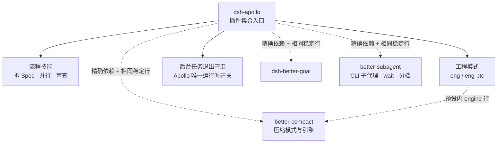
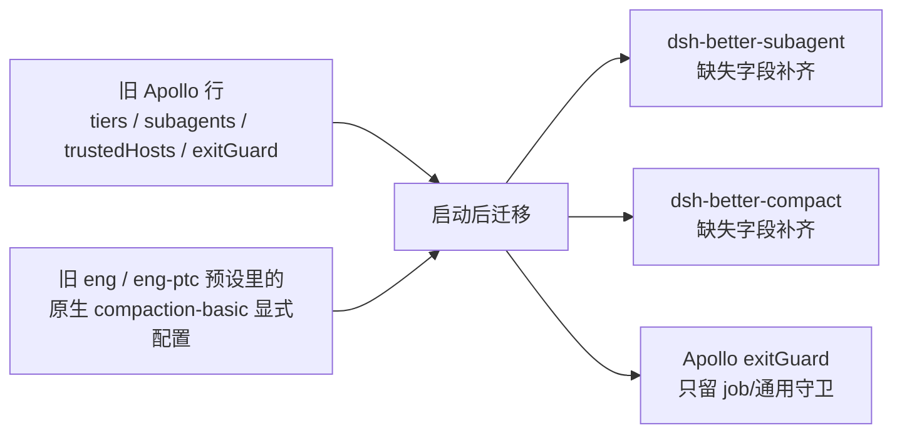

<h1 align="center">dsh-apollo</h1>

<p align="center">
  DeepSeek Harness 的<strong>插件集合入口</strong>：流程技能 · 工程预设 · 独立长期目标 · 子代理增强 · 压缩策略
</p>

<p align="center">
  <a href="https://www.npmjs.com/package/@menghuan1918/dsh-apollo"></a>
  <a href="LICENSE"></a>
  <a href="package.json"></a>
  <a href="package.json"></a>
</p>

<p align="center">
  <a href="#这是什么">是什么</a> ·
  <a href="#能力地图">能力地图</a> ·
  <a href="#安装">安装</a> ·
  <a href="#从-04x-升级">升级</a> ·
  <a href="#设置与行归属">设置</a> ·
  <a href="#独立使用与组合安装">组合</a> ·
  <a href="#faq">FAQ</a> ·
  <a href="docs/DEVELOPMENT.md">开发文档</a>
</p>

## 这是什么

Apollo 是 [DeepSeek Harness](https://github.com/deepseek-ai/deepseek-harness)（DSH）的**插件集合入口**：安装一次，同时得到流程技能、两套工程预设，并把五个各自独立发布、可单独使用的插件装配进同一个 profile：

- **[`dsh-better-goal`](https://github.com/Menghuan1918/dsh-better-goal)**：长期目标、暂停与轮数策略；
- **[`@menghuan1918/dsh-better-subagent`](https://github.com/Menghuan1918/dsh-better-subagent)**：Codex / Claude 可续接 CLI 子代理、`wait_subagent`、运行中子代理守卫、模型分档与子代理提示词；
- **[`dsh-better-compact`](https://github.com/Menghuan1918/dsh-better-compact)**：native / goal / file-handoff 三种压缩模式与只读诊断；
- **[`dsh-better-ask-user`](https://github.com/Menghuan1918/dsh-better-ask-user)**：提问等待、输入续期、Markdown/移动端卡片、超时行为与旧 goal 等待迁移；
- **[`dsh-better-ptc`](https://github.com/Menghuan1918/dsh-better-ptc)**：ask-user 与 subagent 共享的 PTC deadline 豁免单例。

> **0.6.0 的所有权变化**：提问等待从 better-goal 拆到 better-ask-user；PTC deadline 豁免从 Apollo 主行拆到共享 better-ptc。Apollo 只做**装配、通用工程纪律、后台任务退出守卫、旧配置迁移**。Apollo 也不再注册 `/apollo/api/*` —— 该前缀由 better-subagent 作为只读兼容别名拥有。



## 能力地图

| 模块 | 入口 | 提供什么 |
|---|---|---|
| 流程技能 | 会话内用 `/技能名` 或按描述自动选用 | 把大任务拆成可验证的 Spec，按波次实现、审查、验证后合入 |
| 工程预设 | 预设选择器：`eng` / `eng-ptc` | 通用工程纪律、后台任务守卫、完整工作流；压缩用 better-compact 引擎 |
| 子代理增强 | **Plugins → better-subagent 行** | CLI 后台子代理、等待续接、运行中子代理守卫、模型分档 |
| 压缩 | **Plugins → dsh-better-compact 行** | native / goal / handoff、预算、摘要路由、只读诊断 |
| 长期目标 | **Plugins → dsh-better-goal 行** + `/goal` | 每个会话一个持久目标，可暂停、可恢复 |

### 流程技能

| 技能 | 用途 |
|---|---|
| `/brainstorming` | 把大型需求设计为获批的主 Spec 与子 Spec |
| `/exec` | 按依赖分波：worktree → 并行子代理实现 → 审查 → 验证与合并 |
| `/dev` | 实现与审查节点的 prompt、报告结构与失败契约 |
| `/main-agent-driven-development` | 实现一个边界明确的单个任务 |
| `/tdd` | 测试先行、红绿循环、测试边界与反模式 |
| `/diagnosing-bugs` | 先建立反馈循环，再定位和修复根因 |
| `/code-review` | 并行检查仓库标准与原始需求，并排报告 |
| `/handoff` | 把当前上下文整理为交接文档；仅由用户手动触发 |

技能需要在所选预设中挂载 DSH 的技能工具，两套工程预设已挂载。

### 工程预设

| 预设（ID） | 适合 | 关键差异 |
|---|---|---|
| 工程模式 — `eng` | 编码 / 基础设施任务 | 原生工具调用；保留 workflow 工具 |
| 工程(PTC)模式 — `eng-ptc` | 多步、循环、需要过滤汇总的任务 | 工具经 `run_code` 的 TypeScript SDK 调用；与官方 PTC 模式一致不提供 workflow |

在 PTC 模式里，`wait_subagent` / `ask_user_question` 的等待不消耗 `run_code` 的 elapsed budget；普通嵌套工具仍按原预算计时。该豁免由单例 `dsh-better-ptc` 行提供，ask-user 与 subagent 各自向同一服务注册。提问等待由 dsh-better-ask-user 统一管理，默认 120 秒；在它的行设置里可改为 `-1`，普通会话与 goal active 可分别选原 pending 或超时默认选择。两套预设的 `tool-ask-user` 不再固定 `timeout: -1`。

两套预设共用 Apollo 的通用工程纪律（KISS、证据先行、修复根因、防过度设计与过度防御、权限与依赖边界、命令与进程纪律）。**委派规则与模型分档不在 Apollo**：由 better-subagent 在 `agent/created` 时按预设与活配置注册自己的 prompt section。完整组装结果见 [prompts/eng.md](prompts/eng.md) 与 [prompts/eng-ptc.md](prompts/eng-ptc.md)。

两套预设的压缩组里，原生 `compaction-basic` 被替换为 `dsh-better-compact/engine`（与独立 bundle 完全相同的稳定行），保留 `command-compact` 与 `tool-result-pruner`。工程模式不提供自动化任务工具；退出守卫默认关闭，只检查本会话仍运行的后台 job，不管理 pm2、systemd、nohup 等外部进程。

## 安装

需要 Node.js `^22.19.0 || >=24.0.0`，以及 DSH `>=0.2.1-rc.2 <0.3.0`。已验证基线是 DSH `0.2.1-rc.2`。

```sh
# npm 安装（发布后）
dsh plugin --profile <profile> add @menghuan1918/dsh-apollo@0.6.5

# 或从 GitHub main 源码安装（备选）
dsh plugin --profile <profile> add github:Menghuan1918/dsh-apollo
```

> **发布状态**：Apollo `0.6.5` 与 `dsh-better-ask-user@0.1.7` 已发布并经 registry 干净安装验证；`dsh-better-ptc@0.1.0` 已发布。提交的 manifest 使用精确 npm 版本，**没有** `file:` / `link:` / Git 说明符。发布顺序见[发布顺序](#发布顺序)。

安装、升级或换包都会改变运行的代码，必须重启对应 profile 的 DSH 进程；只刷新网页不够。目标行、子代理行、压缩行、共享 PTC 行与 ask-user 行由 Apollo 的 bundle patch 插入，不需要再单独 `add` 五个子包。

> **不要重复添加**：已经显式选中 better-subagent / better-compact bundle 的 profile，再加 Apollo 会形成“双显式来源”。Loader 仍只激活一行，但 DSH 0.2.1-rc.2 会把同一 id 的配置写入拒绝为只读（见[独立使用与组合安装](#独立使用与组合安装)）。只保留一个显式入口。

如果之前通过 GitHub 或 `link:` 安装了旧名 `dsh-apollo`，迁移到 scoped npm 包时请手动处理，不要依赖自动迁移。会话记录会保留，但换包后仍须重启 profile：

```sh
dsh plugin --profile <profile> remove dsh-apollo
dsh plugin --profile <profile> add @menghuan1918/dsh-apollo@0.6.5
```

> `dsh-apollo` 只是旧入口名；unscoped 的 `dsh-apollo` 已被其他项目占用，不要从 npm 安装它。

## 从 0.4.x 升级

0.6.0 把提问等待从 better-goal 移到独立的 dsh-better-ask-user，并把 PTC deadline 豁免移到共享 dsh-better-ptc；better-goal 的旧 `questionTimeoutSeconds` 仍可读取，ask-user 行会做一次性迁移。旧 profile 不需要手工重填配置：Apollo 启动后在 settings/loader 可用时运行一次**幂等迁移**（[src/migrate.js](src/migrate.js)）；ask-user 行的迁移会在其设置服务就绪后运行。

> **0.5.1 迁移修复**：如果旧 profile patch 的 `apollo-skills` 覆盖还带历史名称 `name: dsh-apollo`，DSH 会把 `name` 当 guard 并跳过该覆盖，导致有效配置看起来仍是默认值。0.5.1 从 `configEditor.configuration().override` 恢复这些显式值（含 `false` / `0` / `""` / `[]`），再合并到迁移来源；被跳过的旧预设覆盖（`preset-eng` / `preset-eng-ptc`）同样处理。无需手工修改旧行；升级后重启 profile 即可。



规则：

- **目标行已有的显式用户值优先**；迁移只补缺失字段，不覆盖你在新设置页里改过的值。显式 `false` / `0` / `""` / `[]` 都是值。
- 旧 `exitGuard` 的初值同时复制到 better-subagent 的 `childExitGuard`；Apollo 自己的 `exitGuard` 继续作为后台 job/通用守卫开关，之后两者可独立配置。
- 旧原生 `compaction-basic` 的显式配置（`auto`、阈值、headroom、保留方式、摘要路由、输出上限、重试、`modelPolicies`）补进 better-compact；目标缺失的模式采用默认 `goal`。
- `trustedHosts` 是非 volatile 部署字段，经宿主 configEditor 写到目标行，不绕过字段限制。
- 迁移**不删除**旧配置、不复制 CLI 身份 KV、不复制 goal 状态；写入后重读验证，失败/目标行尚不可写时明确报告“待迁移/需重载”，不会假装成功。
- 旧 `apollo-skills` 行里的 `tiers` / `subagents` / `trustedHosts` 降级为 **deprecated、运行时无效**，只为装载旧 profile 与迁移保留；网页上不再把它们作为活跃子代理设置展示。

升级后：

1. 重启 profile（只刷新网页不算重载）。
2. 迁移写入的压缩设置需要**再重载一次**才会被运行中的引擎采用（引擎使用载入时冻结快照；设置页/inspect 会显示 `requiresReload`）。
3. 如果旧 profile 曾用网页编辑器保存过 `preset-eng` / `preset-eng-ptc` 的整份覆盖，那份覆盖会按 DSH 规则优先于新 bundle 的预设；其中如果还引用原生 `compaction-basic`，需要重新保存/清理该预设覆盖，才能用上新的 engine。
4. 如果旧预设行已经被手动删除，迁移会报告 `source-missing` 而不是假装保留：请按 [dsh-better-compact 的配置表](https://github.com/Menghuan1918/dsh-better-compact#configuration) 手工把旧值填进新的 compact 行，或恢复升级前的 `cordis.patch.yml` 备份。多个预设显式配置无法确定时迁移报告 `ambiguous`，不会猜。

## 设置与行归属

| 行 | 所属包 | 主要设置 | 生效 |
|---|---|---|---|
| `apollo-skills` | Apollo | `exitGuard`（**只**拦运行中后台 job） | volatile，保存即生效 |
| `dsh-better-subagent` | better-subagent | `childExitGuard`、`tiers.*`、两个 CLI 后端、`subagents.eng/global` | volatile，保存即生效 |
| `dsh-better-compact` | better-compact | 模式、auto、阈值/headroom/保留、摘要模型、重试、模型策略 | volatile 保存；**引擎快照需重载 profile** |
| `dsh-better-goal` | goal | 轮数策略 | volatile，保存即生效 |
| `dsh-better-ask-user` | ask-user | 等待时长、输入续期、普通/Goal 超时行为 | volatile，保存即生效；旧 goal 值一次性迁移 |

- Apollo 的最小行页只保留后台任务退出守卫与迁移说明；PTC deadline 豁免由独立的 `dsh-better-ptc` 单例行拥有，没有设置页。
- 子代理页、压缩页分别由两个独立包自己的浏览器半边注册；它们也注册 Apollo 集成槽别名（`@menghuan1918/dsh-apollo#<row>`、`dsh-apollo#<row>`），独立与集成共用同一份实现，不产生三份配置。
- 运行中子代理的拦截与 Apollo 的后台 job 守卫是**两个独立开关**；任意一个关闭都不影响原生工具。
- 原生 `subagent` / `subagent_fork` / `send_message` / `interrupt_agent` 注册表不变；better-subagent 只是在它上面加路由、等待工具与提示词，不拆第二套 registry。

### 什么时候需要重启

| 改动 | 生效方式 |
|---|---|
| Apollo `exitGuard`、子代理行、goal 行设置 | 保存后即时生效 |
| better-compact 设置 | 保存后写入 profile；重启 profile 后引擎采用新快照 |
| 安装 / 升级 / 移除 bundle、修改预设或顶层 patch | 重启对应 profile 的 DSH 进程 |
| 共享 PTC 行 / ask-user 行 / 预设内 `tool-ask-user` 行 | 重启对应 profile 的 DSH 进程（host 逻辑与预设不热更） |
| 已有 CLI 子代理的模型 / effort / profile / 可执行文件 / 初始目录 | 创建时固定；改设置只影响新任务 |
| 已有 CLI 子代理的权限 | 每轮读取最新设置 |

## 独立使用与组合安装

两个新插件都不依赖 Apollo，也可以单独使用：

```sh
# 只装子代理增强
dsh plugin --profile <profile> add @menghuan1918/dsh-better-subagent@0.1.0

# 只装压缩
dsh plugin --profile <profile> add dsh-better-compact@0.1.1

# 只装提问增强（同时需要共享 PTC 行）
dash plugin --profile <profile> add dsh-better-ask-user@0.1.7 dsh-better-ptc@0.1.0
```

独立安装时的行、页面和提示词与 Apollo 集成完全相同；行 id/name 也是同一组稳定值。区别只在**由谁插入这些行**：Apollo 的 bundle patch 自己携带同样的行，因为 DSH 不会自动应用传递依赖的 bundle patch。

| 组合 | 结果 |
|---|---|
| 只有 Apollo | Apollo 插入 goal / subagent / compact companion+engine / 自己的行；工程预设内带 compact engine |
| 只有独立 bundle | 各自插入同样的行；没有 Apollo 的工程预设、技能或 job 守卫 |
| Apollo + 独立 bundle 同时显式选中 | Loader 仍按行 id 只激活**一行**实例，但 DSH 0.2.1-rc.2 会拒绝为同一 id 写入配置：行可读、开关/配置**只读**（见下） |

### 双显式 bundle 的只读限制（已在临时 profile 验证）

在 DSH `0.2.1-rc.2` 上，同一行 id 由两个显式 bundle 插入时：

- 运行实例仍然只有一个：`wait_subagent`、提示词 section、压缩引擎和工具都不会重复；
- 行配置**可以读**（设置页能看到值），但保存会被宿主拒绝（实测信息为 `Configuration for "<id>" is overridden by a home patch or command-line overlay`）；
- 插件管理器里的“组合行不可寻址/只读”标记属于 Web 管理界面，当前 headless 冒烟没有点验该 UI 标签，只验证了实际写入限制。

恢复方法：**只保留一个显式入口**。例如移除独立 bundle 或移除 Apollo，然后重启 profile：

```sh
dsh plugin --profile <profile> remove dsh-better-subagent
dsh plugin --profile <profile> remove dsh-better-compact
# 或反过来移除 Apollo，仅保留独立包
```

不要为了“多一层保险”同时安装两套入口。

### 禁用、卸载与回退

- 移除独立 bundle **不会**移除 Apollo 仍然装配的同一稳定行；反之亦然。文档必须按“有效 row 的来源”而不是 bundle 名判断。
- 彻底移除压缩增强：从 Apollo 组合中移除 Apollo，或把预设/组合改回原生压缩。**只禁用独立 compact bundle 不会恢复 Apollo 预设内的 engine 行**，因为该 engine 由 Apollo 自己的预设 patch 声明；需要移除 Apollo，或恢复一份使用原生 `compaction-basic` 的预设覆盖。
- 彻底移除子代理增强：移除 Apollo（或至少禁用其 `dsh-better-subagent` 行）。原生 create/fork/message/interrupt 仍可用；CLI-only 旧会话需要重新安装 better-subagent 才能续接，其它原生会话不受影响。
- 卸载不删除原生压缩事件、goal 日志或 CLI 身份 KV；handoff 临时文件不是必需依赖，删除后已压缩会话仍可从原生 checkpoint 恢复。
- 回退到 0.4.x 前先备份 profile 的 `cordis.patch.yml`；旧字段仍能装载，但 0.5.x 写入的新行配置不会被 0.4.x 读取。

## 提示词归属

运行时只有一份来源：

- **Apollo**（`eng-mode-instructions`）：通用工程纪律 + `exitGuard` 开启时的 job-only 退出守卫说明；不含委派、分档、CLI 目录或 child guard。
- **better-subagent**（per-Agent sections）：`better-subagent:delegation`（委派 + fast/quality 分档，`eng-ptc` 自行追加 PTC fan-out）、`better-subagent:child-guard`（`childExitGuard` 开启时）、`better-subagent:cli-subagents`（有启用后端时）。
- **better-compact**：不注册系统提示词段。

[prompts/eng.md](prompts/eng.md) / [prompts/eng-ptc.md](prompts/eng-ptc.md) 由真实 headless 宿主装配生成（`npm run prompts`），临时 profile 会复制三个独立包的真实发布文件，所以快照里的新插件段落来自它们自己的运行时实现，而不是 Apollo 的第二份副本。

## Specs 与发布包

本仓库的私有设计 Specs（`docs/specs/`）**不进入 Git 提交，也不进入 npm 包**：

- 它们由本仓库的 Git 私有排除规则忽略；
- `package.json` 的 `files` 只列入 `docs/DEVELOPMENT.md`，并额外用 [.npmignore](.npmignore) 排除 `docs/specs/`；
- `tests/packaging.test.mjs` 直接运行 `npm pack --dry-run --json`，断言发布清单没有 Specs、测试、脚本、快照或 tarball。

发布顺序：**先发布并验证五个独立包（`dsh-better-ask-user@0.1.7`、`dsh-better-ptc@0.1.0`、`@menghuan1918/dsh-better-subagent@0.2.0`、`dsh-better-goal@0.2.1`、`dsh-better-compact@0.1.2`），再发布 Apollo 0.6.5**。Apollo 的精确依赖指向尚不存在的版本时，`npm install` 会失败；不要用开发 `file:`/`link:` 依赖发布。各子仓各自有 trusted publishing workflow；Apollo 的 [release workflow](.github/workflows/release.yml) 只发布本包。

## 验证状态（诚实记录）

在本实现提交时验证过（命令与结果见 [docs/DEVELOPMENT.md](docs/DEVELOPMENT.md)）：

- `npm test`：配置/装配/漂移/迁移纯函数/settings/客户端/prompt/发布清单全部通过，含真实 temp-profile 迁移测试；
- `npm run prompts`：用发布布局复制 Apollo + 五个独立包，由真实 headless 宿主重新生成两份快照；
- `npm pack --dry-run --json`：发布清单无 Specs/tests/scripts/prompts/tarball；
- `node scripts/runtime-smoke.mjs apollo|standalone|both`：临时 profile + 脚本化 LLM 适配器（无凭据），覆盖单实例行、旧配置迁移、eng 回合、native subagent create/wait、手动 `/compact`、inspect、真实后台 job 退出守卫、保存→`requiresReload`→重启→`activeConfig`、独立组合与双显式 bundle 的只读限制。

**未验证 / 明确限制**：

- 0.6.5 与 ask-user 0.1.7 已发布；registry 干净安装验证通过（Web boot + 五 tab hub）。
- 未修改或重启用户当前运行的 profile，未验证当前 GUI（`http://127.0.0.1:3384`）的设置页/卡片；S3 视觉设置页的 GUI 验收归 S3/最终宿主验收。
- 未运行真实 Codex/Claude CLI 的真实模型回合（那属于两个子包自己的验证；Apollo 侧本轮只用脚本化适配器）。
- 真实模型摘要保真、缓存命中率与跨版本预设漂移仍需按实际环境复验。

## 开发

```sh
npm install
npm test
npm run prompts   # 需要 DSH_PACKAGE_ROOT
npm run smoke -- apollo   # 或 standalone / both / all，需要 DSH_PACKAGE_ROOT
```

实现、迁移契约、测试细节与冒烟场景见 [docs/DEVELOPMENT.md](docs/DEVELOPMENT.md)。

## 许可与致谢

本包采用 **GPL-3.0-or-later**，见 [LICENSE](LICENSE)。工程预设改编自 DeepSeek Harness 的 MIT 标准预设与 PTC 预设（[预设声明](presets/eng/NOTICE)、[MIT 许可](third-party/LICENSE-MIT-dsh-standard-preset)）；`tdd` / `diagnosing-bugs` 改编自 [mattpocock/skills](https://github.com/mattpocock/skills)（[第三方声明](third-party/NOTICE-mattpocock-skills)）。子代理与压缩实现分别在各自仓库保留版权与许可声明。
