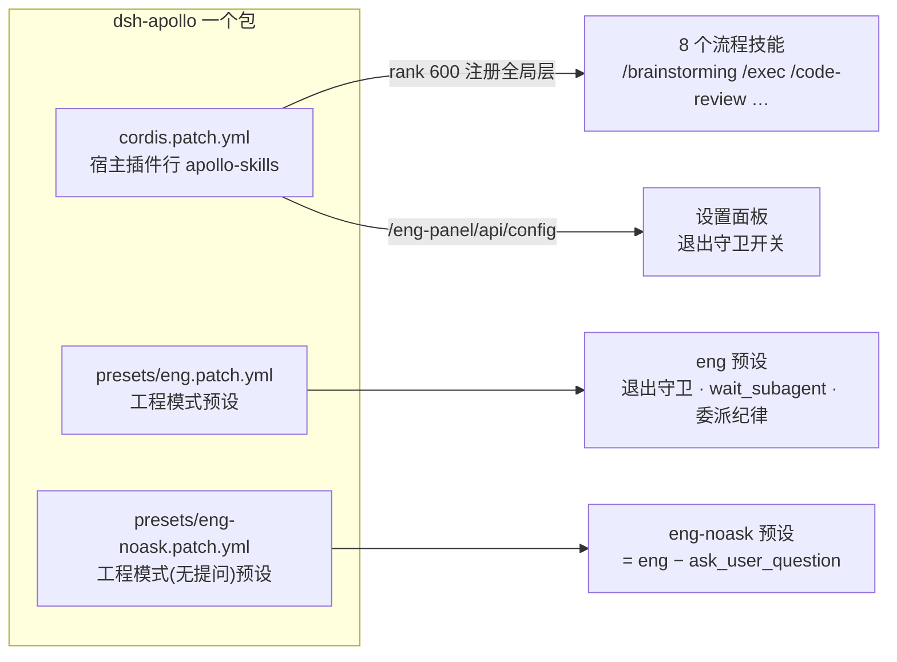
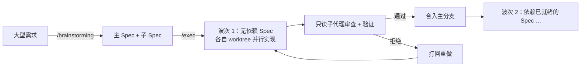
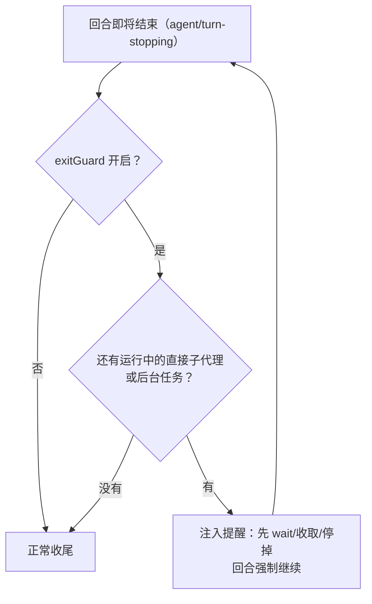

# dsh-apollo

> 一次会话做不完的大任务，拆成可独立实现、可独立验证的子任务：**逐波并行执行 → 子代理只读审查 → 验证通过才合入**。

DSH（DeepSeek Harness）插件，一包三件：**流程技能包** + **工程模式（eng）agent 预设** + **设置面板**。零依赖、无构建步骤、纯 ESM。



---

## 我们做了哪些优化

按四个主题分组，每条先说**做了什么**；设计理由集中在下一节「为什么这些优化行得通」。

### 一、编排与流程：让大任务真的能做完

| # | 优化 | 做法 |
|---|---|---|
| 1 | **需求 → 协同 Spec** | `/brainstorming` 把大型需求设计为获批的主 Spec + 子 Spec，`/exec` 逐 Spec 开 worktree、按依赖分波次用 `workflow` 并行执行 |
| 2 | **验证通过才合入** | 每个实现节点配一个**只读**子代理审查节点，报告 schema、失败语义由 `dev` 技能约定；审查/验证不过的 Spec 回合不入主分支 |
| 3 | **单任务快速通道** | 边界明确的单个任务走 `/main-agent-driven-development`（预建/独立 worktree 两种模式），实现节点捆绑 `tdd` 与 `diagnosing-bugs` 纪律 |
| 4 | **双轴代码审查** | `/code-review` 并行派两路子代理：Standards（是否遵守仓库编码标准）+ Spec（是否符合原始需求），并排报告 |
| 5 | **模型档位一处定义** | `exec` 的 workflow 脚本顶部一个 `quality` 常量；**留空即子代理继承父会话路由**，任何环境开箱即跑 |



### 二、工程模式预设：把工程纪律装进 preset

| # | 优化 | 做法 |
|---|---|---|
| 6 | **退出守卫** | `agent/turn-stopping` 时若仍有运行中的直接子代理或后台任务，注入提醒强制回合继续——不允许「活没干完就收尾」（默认关，`eng.json` 或设置面板开启） |
| 7 | **委派/编排纪律进预设** | eng 专属提示词段（`mode-instructions`）：开局侦察默认并行委派、转委派阈值、写入范围不重叠等，只写其它表面未述的 delta |
| 8 | **`wait_subagent` 工具** | 一次调用并发等待全部直接子代理，只回短 done 行；子代理的完整内容由框架 settlement notice 送达，不占上下文 |
| 9 | **无提问变体** | `eng-noask`（工程模式(无提问)）：会话没有 `ask_user_question` 工具，提示词加「不提问、自主决策、假设写进报告」纪律 |



### 三、交付与兼容性：跟着 DSH 0.1.7 的官方机制走

| # | 优化 | 做法 |
|---|---|---|
| 10 | **bundle patch 数组交付** | 预设不再用 sync-on-boot 写副本，改为 `package.json` 的 `dsh.bundle.patch` 按序加载三份 patch：`cordis.patch.yml`（宿主插件行）+ 两份预设行 |
| 11 | **裸子路径引用本地插件** | 预设里的本地插件模块写成 `dsh-apollo/presets/eng/plugins/exit-guard/index.js` 这样的裸子路径，由 `exports["./presets/*"]` 映射 |
| 12 | **宿主插件严格一行** | 宿主半边只插入一行 `apollo-skills`，浏览器半边与 node 半边都挂在这一行上 |
| 13 | **预发布版 semver 范围** | `engines.dsh: ">=0.1.7-rc.1 <0.1.8"`——逐字带上 `-rc.1`，让 `0.1.7-rc.2` 这类预发布版落在范围内 |
| 14 | **有意不声明 `@deepseek-ai/*` peer** | `peerDependencies` 只留 `react`；实际兼容性由 `engines.dsh` + 漂移自检共同约束 |
| 15 | **上游漂移自检** | eng 预设是内置 `standard` 的整块 fork，`node --test` 里的 `upstream-drift.test.mjs` 拿本机 DSH 逐行对照，上游有而 eng 没有的行**直接判失败并列出该补哪一行** |

### 四、健壮性与安全：故障一律有兜底

| # | 优化 | 做法 |
|---|---|---|
| 16 | **配置故障回退默认** | `eng.json` 缺失/损坏/形状非法一律回退「守卫关闭」，绝不抛错；旧名 `atlas.json` 只读回退，写入永远落 `eng.json` |
| 17 | **面板默认只信本机** | `/eng-panel/api/config` 默认仅接受 **loopback Host + 同源标志**（DNS-rebinding / 跨站防御）；反代域名需显式 `trustedHosts` 白名单 |
| 18 | **守卫只看本地注册表** | 退出守卫只检查 DSH 本地 job 注册表与直接子代理，不碰 pm2/systemd/nohup 托管的跨回合常驻进程；用户中断（Esc）不受影响 |

---

## 为什么这些优化行得通

### 编排与流程

**1–2. 拆 Spec + 审查 + 验证后才合入，为什么比「一个会话硬扛」可靠？**
LLM 的上下文和注意力都是有限资源：一个超大任务塞在单会话里，后期必然丢前期约束。拆成独立 Spec 后，每个子代理拿一份**全新的、只装当前任务的上下文**，实现质量不随任务总长度衰减。worktree 隔离从物理上保证并行子代理写入范围不重叠；审查节点是**另一个**子代理且只读——它没有实现者的路径依赖，专挑实现者自己的盲区；「验证通过才合入」让主分支在任何波次结束后都处于可工作状态，失败的代价被限制在单个 worktree 内。

**3. 捆绑 tdd / diagnosing-bugs 的意义：** 实现节点的纪律（红→绿循环、先建反馈循环再修 bug）依赖这两个技能。把它们打进包里，行为就不依赖用户机器上装了什么——`main-agent-driven-development` 引用的参考资料永远在场。

**4. 双轴审查为什么并行两路：** 「代码风格对不对」和「需求做对没有」是两个独立问题，混在一个 prompt 里容易互相稀释。两路子代理各查一轴、并排报告，互不抢占注意力。

**5. `quality` 留空继承父路由：** 固定写死 provider/model 的脚本换个环境就废；留空则任何机器都能跑。要固定档位时只需改脚本顶部**一处**，改动的成本和被遗忘的概率都最低。

### 工程模式预设

**6. 退出守卫解决的真实问题：** 没有守卫时，agent 回合可能在子代理/后台任务还在跑时就「收尾」——表现为汇报完成但实际没收果实，甚至留下孤儿任务。守卫钩在 `agent/turn-stopping` 上：收尾前发现注册表里还有活，就注入提醒把回合推回去继续。它**只在开启时介入**、只看本地注册表，所以判断是确定性的，不会误伤；Esc 中断路径不经过守卫，用户永远保有最终控制权。

**7. 纪律放预设里而不是全靠全局 AGENTS.md：** 预设随包分发、随版本演进，纪律和工具目录（有哪些工具可用）始终自洽。`mode-instructions` 只写 delta（其它表面没说的部分），避免和 DSH 内置提示词互相矛盾——两份权威必然漂移，一份 delta 不会。

**8. `wait_subagent` 为什么只回短行：** 逐个等待子代理既串行慢、又把每个子代理的完整输出灌进父上下文。一次并发等全部 + 只回 done 行，把「等待」的 token 成本压到最低，完整内容仍由框架的 settlement notice 正常送达，不丢信息。

**9. eng-noask 用「整树拷贝再剔除一行」维护：** 它是 eng 的 `config.plugins` 整块拷贝、删除 `tool-ask-user` 行、改写两处 plan-mode 引用。手工维护两棵树必然漂移，所以 `node --test` 会拦住两块之间超出「那一行」的任何分叉——拷贝 + 测试兜底，比抽象出继承机制简单且可靠（DSH 预设本来就没有 extends/include）。

### 交付与兼容性

**10. bundle patch 取代 sync-on-boot：** 旧机制把预设树写进 `<dshHome>/.agent-presets`，而 DSH 0.1.7 不再扫描该目录——副本成了死数据，还是「同一份预设两个事实源」的漂移温床。bundle patch 是 0.1.7 的官方预设机制：预设内容随包版本走，包就是唯一事实源，升级即生效，没有残留副本。（从 0.2.x 升级的老用户请手动清理：`rm -rf ~/.dsh/.agent-presets/eng ~/.dsh/.agent-presets/eng-noask`。）

**11. 裸子路径：** 0.1.7 从 profile 目录的 `node_modules` 解析 `config.plugins` 里的名字——本包在那里被安装或 link，`exports["./presets/*"]` 把子路径映射进包内。顺着解析规则写路径，而不是赌相对路径的解析基准。

**12. 宿主行为什么必须是单行（硬约束，不是偏好）：** 浏览器半边（`dsh.client`）由插件行的**包清单**发现，而 `dsh-client-modules` 只接受裸包名/两段 scoped 名，并且**拒绝第二个解析到同一包名的活跃行**——拆两行就直接加载失败。预设行则不需要经过 node 半边：0.1.7 的预设机制直接从 bundle patch 读 `config.plugins`。

**13. `>=0.1.7-rc.1` 的写法是踩过坑的：** npm 的 range **默认不匹配预发布版**。写成 `>=0.1.7` 会把所有 0.1.7 预发布版排除在外；逐字带上 `-rc.1`，`0.1.7-rc.2` 才能落在范围内。兼容性声明不是形式主义：0.1.7-rc.2 已实测零适配（2026-09-26：本包测试 67/67，隔离 rc.2 实例里预设注册 / eng 会话挂载 / 技能目录 / 客户端半边 / 面板路由全通；rc.1 与 rc.2 的上游预设基准逐字节相同）。

**14. 不声明 `@deepseek-ai/*` peer 是有意的：** 0.1.7 新增的兼容门禁只按 `peerDependencies` 里的 `@deepseek-ai/dsh*` 条目做 semver 判定——把这套包写进 peer，反而可能在 DSH 预发布/补丁版上被门禁**误拒**。声明式约束交给 `engines.dsh`（当前 DSH 不强制，但它是文档），实质性约束交给漂移自检，各管各的，互不误伤。

**15. 漂移自检是 fork 的保险费：** DSH 预设没有继承机制，eng 只能整块 fork `standard`——拷贝就会漂移，这不是态度问题是机制问题。`upstream-drift.test.mjs` 拿本机 DSH 的 `standard.patch.yml`（嵌套与 flat 两种安装布局都认）逐行对照：上游新增而 eng 没跟上的行直接失败并列出补哪行，同时断言 `engines.dsh` 覆盖本机已安装版本。它抓到过真问题：2026-09-12 补回的 `@deepseek-ai/dsh-tool-present`——缺这行时没有任何报错，只是静默没有 `present` 工具。换 DSH 版本预演时，用 `DSH_PACKAGE_ROOT=<dsh 包目录>` 把基准指向隔离安装即可提前检验。

### 健壮性与安全

**16. 配置永不抛错：** 配置故障既不该让守卫**意外生效**（用户没开却被拦），也不该让**回合结束路径崩溃**（比守卫失效严重得多）。所以一切异常都回退到「关闭」这个最保守默认；`atlas.json` → `eng.json` 的迁移在面板首次保存时自动完成，用户无感。

**17. 面板的安全边界：** 一个能读写本地配置的 HTTP 端点，默认姿态必须是「只信本机」——loopback Host + 同源标志挡住 DNS-rebinding 和跨站请求。走反代域名是显式 opt-in（`trustedHosts`），`declareOwnsHost` 的安全边界随反代信任，注释里写明了「仅在受信代理下开启」。安全默认值 + 显式放宽，比「默认开放再让用户自己加固」可靠。

**18. 守卫的边界划在本地注册表：** dev server、watcher 这类跨回合常驻进程**本来就不该**挡住回合收尾。把边界划在「DSH job 注册表 + 直接子代理」，常驻服务用 pm2/systemd/nohup 管理（或保持开关关闭），各归各管，守卫永远不会和常驻运维习惯打架。

---

## 安装

```sh
# 从 GitHub 装（推荐）
dsh plugin --profile <name> add github:Menghuan1918/dsh-apollo

# 或本地目录
dsh plugin --profile <name> add link:/path/to/dsh-apollo

dsh --profile <name> --dump-config   # 应出现 "# == dsh-apollo" 层与 apollo-skills 行
```

重启该 profile 的 dsh 进程后生效：

- 技能目录出现 8 个流程技能（注册在全局层，任何挂载 `tool-skill` 的 preset 都看得到）；
- 预设选择器出现「工程模式」（`order: 10`）与「工程模式(无提问)」（`order: 11`），排在内置 preset（standard=1、ptc=2、minimal=3、cordis=4）之后。

把工程模式设为默认（用户级，不随仓库分发）：在 Web 界面的预设选择器里选择并保存——0.1.7 起默认值经 `agent-presets` settings namespace 持久化。

卸载：

```sh
dsh plugin --profile <name> remove dsh-apollo
```

## 流程技能一览

| 技能 | 入口 | 职责 |
|---|---|---|
| brainstorming | `/brainstorming` | 把大型需求设计为获批的主 Spec + 子 Spec |
| exec | `/exec` | 逐 Spec worktree、波次 workflow 执行、合并、最终代码审查 |
| dev | 被 `/exec` 引用 | 实现与审查节点的 prompt 契约、报告 schema、失败语义 |
| main-agent-driven-development | `/main-agent-driven-development` | 单个边界明确的实现任务（预建/独立 worktree 模式） |
| tdd | 被 `main-agent-driven-development` 引用 | 红→绿循环的参考：好测试的标准、seam 选择、反模式 |
| diagnosing-bugs | 被 `main-agent-driven-development` 引用 | 难 bug 的诊断纪律：先建反馈循环，再假设、定位、修复 |
| code-review | `/code-review` | 双轴（Standards/Spec）并行子代理代码审查 |
| handoff | `/handoff` | 把当前对话压缩成交接文档 |

约定：

- Spec 落盘优先 `.workspace-docs/specs/`（工作区有该约定时），否则目标仓库自己的 specs 目录；写入 `.workspace-docs/` 时带 OKF 头。交接文档（`/handoff`）同理落 `.workspace-docs/notes/`。
- 可视化辅助写自包含静态 HTML 到系统临时目录，不起服务；DSH 界面直接打开预览，反馈走对话。
- 技能注册细节：宿主插件扫描包内 `skills/*/SKILL.md`，解析 frontmatter（`name` / `description` / `whenToUse` / `disable-model-invocation` / `user-invocable`，其余键进 metadata），以 rank 600 注册到 `ctx.skills` 全局层；技能正文中的相对资源引用按该技能目录解析。

捆绑的 `tdd` 与 `diagnosing-bugs` 来自 [mattpocock/skills](https://github.com/mattpocock/skills)（MIT，Copyright © 2026 Matt Pocock），许可证原文见 `third-party/NOTICE-mattpocock-skills`。

## 运行时配置

`<dshHome>/eng.json`：

```json
{
  "exitGuard": false
}
```

- `exitGuard`（默认 `false`，**显式开关**）：退出守卫总开关。每次回合结束前重读，改配置即时生效，无需重启。
- dsh home 解析集中在 `src/dsh-home.js`（面板与预设本地插件共用）。

### 设置面板

设置页 → Plugins 分区 → 「工程模式」标签页（开关 + 保存，即时生效）。

经反向代理域名访问 GUI 时，把该域名加入 profile 层的 `trustedHosts`：

```yaml
# ~/.dsh/profiles/<name>/cordis.patch.yml
- id: apollo-skills
  config:
    trustedHosts: [dsh.example.com]
    # 可选：让官方 client 把反代页面视作 loopback，设置页回到 host 持久化。
    # 安全边界随反代信任，仅在受信代理下开启。
    declareOwnsHost: true
```

## 预设内部结构

预设以 bundle patch 文件交付，`presets/<id>/` 目录只承载本地插件模块：

| 文件 | 作用 |
|---|---|
| `presets/eng.patch.yml` | 预设声明与组合（`config.plugins` 块改编自 DSH 内置 standard preset，MIT，见 `presets/eng/NOTICE`）；元数据（名称「工程模式」、`order: 10`）并入 `config`，`config.id` 为 `eng` |
| `presets/eng/plugins/exit-guard/` | 退出守卫：`agent/turn-stopping` 时注入提醒 |
| `presets/eng/plugins/wait-subagent/` | `wait_subagent` 工具 |
| `presets/eng/plugins/mode-instructions/` | eng 专属提示词段（委派纪律 2026-09-11 从全局 `~/.dsh/AGENTS.md` 迁入；模型档位留在全局，因其跟随本机路由配置） |
| `presets/eng/plugins/lib/atlas-config.js` | `<dshHome>/eng.json` 读取 |

`presets/eng-noask.patch.yml`（`order: 11`）是 eng 的拷贝变体，本地插件行指向 `presets/eng-noask/plugins/` 自己的副本，`eng.json` 配置两预设共用。改 eng 后把块重拷一遍再重做剔除——测试会拦住漂移。

无 watcher：技能与预设内容随包版本走，改动在进程重启后生效。

## 已知限制

- **支持的 DSH 版本**：`engines.dsh: ">=0.1.7-rc.1 <0.1.8"`（上界挡住 0.1.8）。
- 技能内容与预设无热更新，改完需重启对应 profile 的 dsh 进程。
- 跨版本升级 DSH 后先 `node --test`（漂移自检会列出该补的行），再重启。
- 技能正文与 `/exec` 注入子代理的 prompt 都是中文；非中文用户需要自行改文案。
- 本包按 `link:`、本地路径或 `github:` 安装使用，未发布到任何 npm registry。

## 开发

```sh
node --test          # 67 例：技能 provider、捆绑技能目录、预设 patch 结构与漂移自检
                     # （含 engines.dsh 版本覆盖断言）、配置读取、退出守卫、
                     # wait_subagent、面板路由
```

漂移自检需要本机 DSH 带 `dsh-web-app/presets/standard.patch.yml`（0.1.7 布局；嵌套与 flat 都认），否则其中三例 skip；可用 `DSH_PACKAGE_ROOT=<dsh 包目录>` 指向隔离预演安装来跑。`presets/eng.patch.yml` 是预设行清单的**唯一事实源**——旧机制（`agent.cordis.yml` + `preset.yml` + `.agent-presets` 同步副本）已删除，结构自检会拒绝它们复活。

## 许可

本包整体以 **GPL-3.0-or-later** 发布，全文见 `LICENSE`。

捆绑的两部分来自 MIT 许可的上游，其原始许可与署名一并保留（GPL-3.0 与 MIT 兼容）：

| 内容 | 来源 | 许可 |
|---|---|---|
| `presets/eng.patch.yml` 的 `config.plugins` 块（改编自 DSH 内置 `standard` 预设） | DeepSeek Harness | MIT，见 `presets/eng/NOTICE` 与 `third-party/LICENSE-MIT-dsh-standard-preset` |
| `skills/tdd/`、`skills/diagnosing-bugs/` | [mattpocock/skills](https://github.com/mattpocock/skills) | MIT，Copyright © 2026 Matt Pocock，见 `third-party/NOTICE-mattpocock-skills` |
